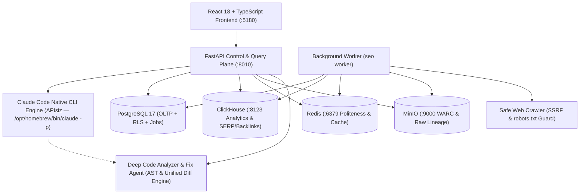

# ARCHITECTURE — SEO Growth Intelligence Platform

## 1. Sistem Mimarisi

## 2. Claude Code CLI Doğrudan AI Katmanı (APIsiz Mimarisi)

Kullanıcı direktifi doğrultusunda sistem, herhangi bir üçüncü taraf Anthropic API anahtarı veya SDK gerektirmeksizin doğrudan yerel **Claude Code CLI** (`claude`) binary'si üzerinden yönetilir:

1. **İkili (Binary) Keşfi:** Sistem `/opt/homebrew/bin/claude`, `/usr/local/bin/claude` ve ortam `PATH` değişkeni üzerinden CLI'yı otonom tespit eder.
2. **Non-Interactive JSON Yürütme:** Tüm sorgular `claude -p <prompt> --output-format json` formatında çalıştırılır.
3. **Kota ve Sağlık Yönetimi:** Claude Code'un kullanım limiti (`usage_limit_reached` / 429) veya kimlik doğrulama durumu anlık algılanır; sistem asla çökmez ve sıfırlanma zamanını (`resets 5pm ...`) kullanıcıya net şekilde sunar.
4. **Sıfır Sahte Veri Kuralı (§2.3):** Sayısal metrikler ASLA Claude Code'a uydurtulmaz. Yalnızca PostgreSQL ve ClickHouse'dan doğrulanmış sayılar `TRUSTED_FACTS` olarak Claude Code'a beslenir.

## 3. Veri İzolasyonu ve Kaynak Sınıfı Kuralları
1. **Kiracı İzolasyonu (Multi-Tenancy):**
   - PostgreSQL'de tüm kiracı tabloları `org_id` veya `site_id` üzerinden Row-Level Security (RLS) ile korunur (`app.org_id`).
   - ClickHouse sorgularında kiracıya özel tablolar `tenant_query` korumasıyla zorunlu `tenant_id` filtresinden geçer.
2. **Kaynak Sınıfı Ayrımı (`source_class`):**
   - `FIRST_PARTY`: GSC, GA4, Bing Webmaster, sunucu logları, bağlı yerel kaynak kodu.
   - `OBSERVED`: Kendi crawler'ımız, Common Crawl, CrUX saha verisi.
   - `PROVIDER`: DataForSEO, Google Ads Keyword Planner, PageSpeed Insights.
   - `MODELED`: KD-1 zorluk modeli, CTR/Trafik tahmini, STL tahminleme, DiD etki ölçümü.
   - `AI`: Claude Code CLI çıktıları, prompt izolasyonu ve AI arama görünürlük yanıtları.
   - `DEMO`: Yalnızca Demo modunda kullanılan deterministik sentetik sağlayıcı verisi (`is_synthetic=True`).

## 4. 8 Faktörlü Matematiksel Öncelik Skorlama Modeli
`priority_score = min(100.0, (impact_weight * 0.25 + urgency_weight * 0.20 + traffic_potential * 0.15 + ranking_potential * 0.15 + (100.0 - effort_cost) * 0.10 + resource_feasibility * 0.05 + business_alignment * 0.05 + risk_factor * 0.05) * confidence_score)`

## 5. 9 Adımlı Güvenli Kod Düzeltme Yaşam Döngüsü (Safe Fix Lifecycle)
1. Framework Tespiti (`Next.js`, `Nuxt`, `React`, `FastAPI`, `Django`, `WordPress`, `Static HTML`).
2. AST & Template İndeksleme.
3. Kök Neden ve Satır Eşleme.
4. Unified Diff Önerisi Oluşturma (`proposed`).
5. **Kullanıcı Onay Kapısı** (`user_approved=True` olmadan hiçbir dosya değiştirilemez).
6. Değişiklik Öncesi Otomatik Yedekleme (`.bak`).
7. Temiz Tekil Yama Uygulama.
8. Otomatik Sözdizimi ve Doğrulama Kontrolü.
9. Tek Tıkla Geri Alma (Rollback).
